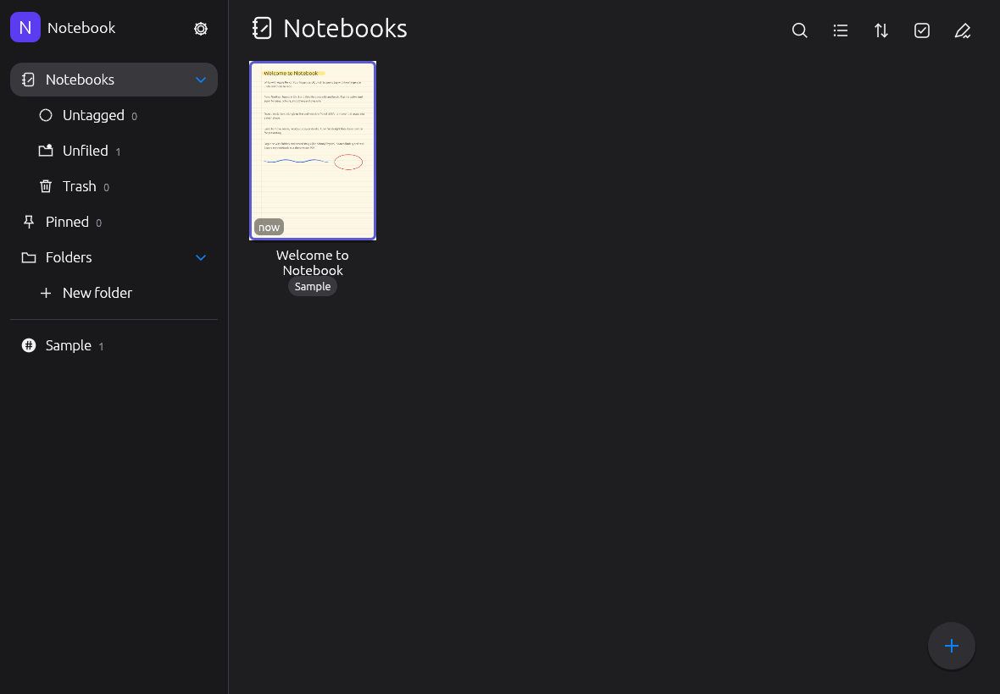
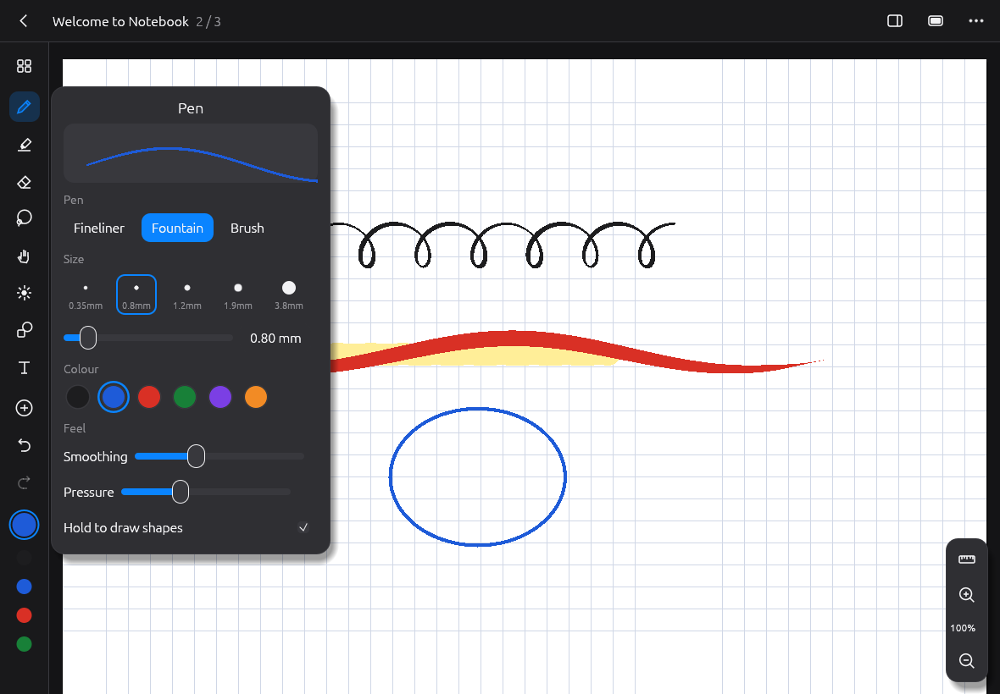
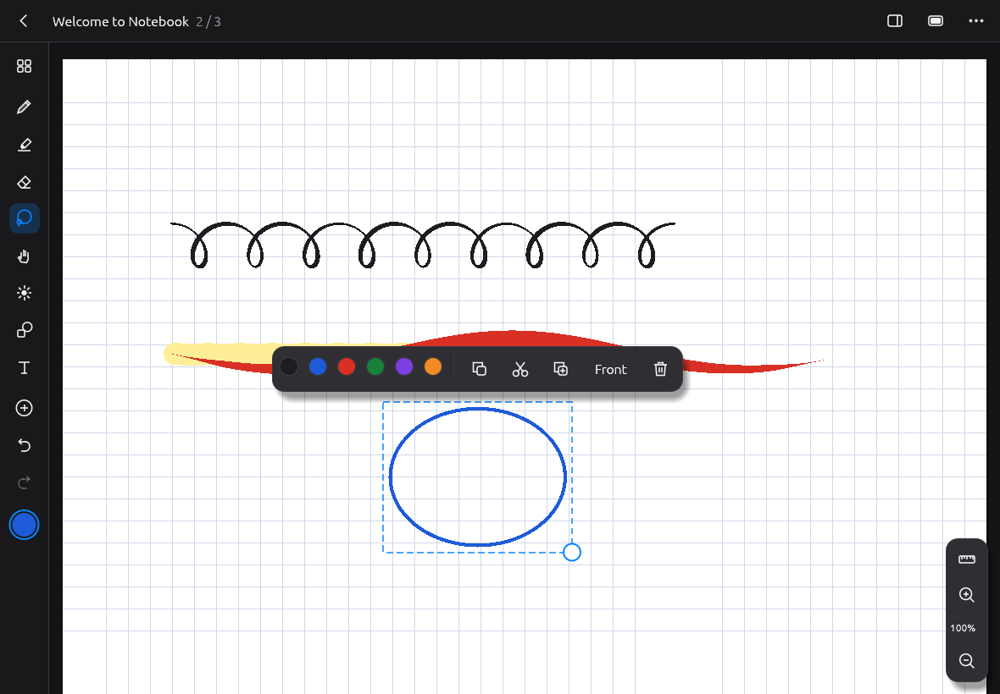
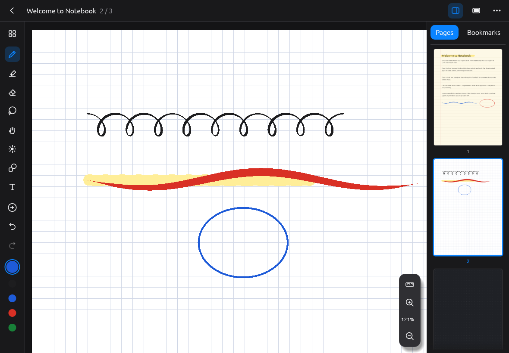
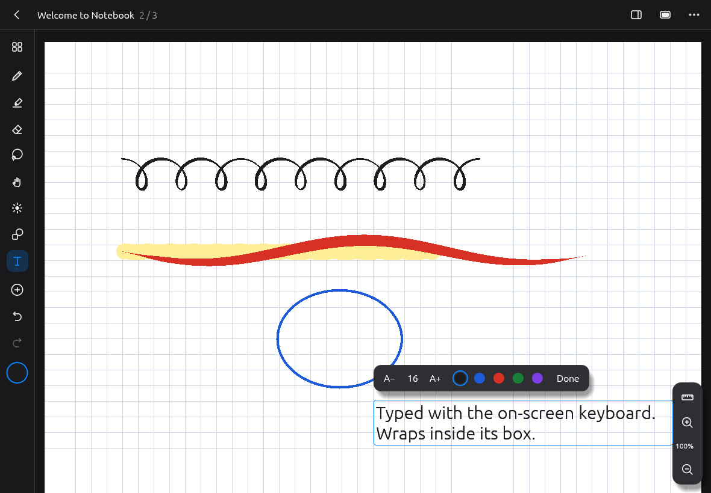
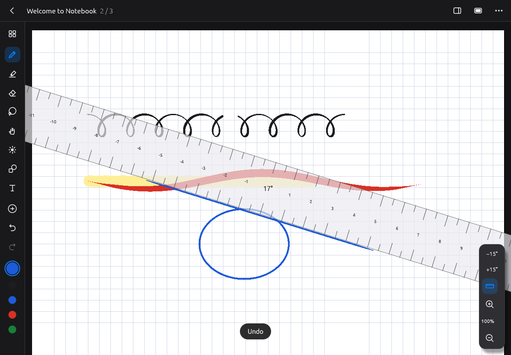

# Notebook v1

A handwriting notebook for iPad and Apple Pencil, written fully in Rust.
It's our own app, inspired by Noteful's feature set. Everything Noteful
sells as Pro is included for free, plus some extras.

## What it does

**Writing**
- Three pens: **Fineliner** (even line), **Fountain** (thick/thin from pressure *and*
  stroke direction, like a real nib) and **Brush** (strong pressure, tapered ends).
- Sizes 0.35 / 0.8 / 1.2 / 1.9 / 3.8 mm plus a fine slider; unlimited favourite colours
  and a full palette with a custom colour picker.
- Highlighter that always sits *under* the writing (never dulls the ink), with an
  optional straight-line mode.
- Adjustable smoothing and pressure sensitivity.
- **Hold to snap**: draw a line, circle, rectangle or triangle and keep the Pencil
  still for half a second; it becomes a clean shape.
- Eraser: whole-stroke or **precise** (cuts strokes apart), and "highlighter only".
- Shapes tool (line, arrow, rectangle, ellipse; fill and dashed options).
- Text boxes (on-screen or hardware keyboard), size and colour.
- Lasso: move, resize, recolour, copy, cut, duplicate, bring to front, delete.
  Tap an item to select just that item.
- Ruler: strokes started along its edge become perfectly straight; rotate with two
  fingers or ±15° buttons.
- Laser pointer for presenting (fades, never saved).
- Unlimited undo/redo; **two-finger tap = undo, three-finger tap = redo**.

**Apple Pencil and touch**
- The Pencil writes; fingers scroll and pinch-zoom. This switches on by itself
  the first time a Pencil is used (palm rejection). It can be changed in settings.
- Pages zoom from 25% to 800% and stay sharp because ink is vector geometry
  drawn on the GPU (Metal) with 4× anti-aliasing.

**Pages**
- Templates: blank, lined, narrow lined, grid, dotted, Cornell, to-do, music, storyboard.
- Papers: white, cream, gray, night. Per page, or applied to all pages.
- Page sidebar with live thumbnails, full-screen page overview, bookmarks,
  insert/duplicate/move/delete pages.

**Library**
- Smart lists: Notebooks, Untagged, Unfiled, Trash (auto-empties after 30 days), Pinned.
- Folders and **nested tags** (`School/Physics`), with counts.
- Search across titles, tags *and typed text*.
- Grid or list view, sort by modified/opened/created/name, multi-select for bulk
  move/tag/pin/trash, quick note, cover colours.

**Files**
- Export a notebook as a **vector PDF** (sharp at any zoom) or a page as PNG.
- Daily automatic backup (last 7 kept) and "Back up now".
- Exports and backups show up in **Files › On My iPad › Notebook**.
- Autosave runs on a background thread, so saving never interrupts writing.

## Build and run on your iPad

You need a Mac with Xcode, an iPad, and a free Apple ID.

1. Install Rust and the iPad target:
   ```sh
   curl --proto '=https' --tlsv1.2 -sSf https://sh.rustup.rs | sh
   rustup target add aarch64-apple-ios aarch64-apple-ios-sim
   ```
2. Generate the Xcode project:
   ```sh
   brew install xcodegen
   cd notebook-v1/ios && xcodegen
   open Notebook.xcodeproj
   ```
3. In Xcode, select the **Notebook** target, open **Signing & Capabilities**,
   choose your team, and change the bundle identifier to something unique
   (e.g. `com.yourname.notebook`).
4. Plug in the iPad (enable Developer Mode on it when asked), select it as the
   run destination and press **Run**. The first build takes a few minutes because
   it compiles the Rust app in release mode.

How it's put together: Xcode builds a tiny placeholder app. The `build-rust.sh`
step then replaces its executable with the Rust binary before Xcode signs it,
so the app that runs is 100% Rust.

## Run on a computer (for development)

```sh
cargo run -p notebook_app --release
```
Mouse = pen (pressure 0.5); scroll wheel scrolls; Ctrl/⌘ + wheel zooms.
Keyboard: P/H/E/L/S/T for tools, ⌘Z / ⇧⌘Z, ⌘C/⌘X/⌘V/⌘D, Delete, ⌘A.

## Tests

```sh
cargo test --workspace                     # core: ink, shapes, library, storage, PDF
scripts/autotest.sh                        # Linux: drives the real app with simulated Pencil input
```
The autotest checks shape snapping, lasso, the text tool, two-finger undo, the
precise eraser, the ruler, PDF export and saving. It also saves screenshots of
every screen.

## Code layout

```
crates/core    Pure Rust, no UI. Document model, ink smoothing and pen models,
               shape recognition, hit testing, undo history, library/tags/search,
               storage, CPU renderer (thumbnails/PNG) and the vector PDF writer.
crates/app     The app (egui + eframe on winit/wgpu). Library screen, editor,
               canvas renderer with cached GPU meshes, Pencil/finger input.
ios/           Xcode project spec (XcodeGen), icon, Rust build step.
```

## Known limits (v1)

- **Not run on a real iPad yet.** The iPad build compiles cleanly
  (`cargo check --target aarch64-apple-ios`). All features were tested on Linux
  with simulated Pencil touches. Pencil feel needs testing on a real device.
- winit reports the Pencil at the display rate (120 Hz on ProMotion iPads, 60 Hz
  on others), not the Pencil's full 240 Hz. Curve smoothing fills the gaps.
- Not in v1 yet: importing PDFs or images, audio recording, layers, iCloud sync,
  Pencil double-tap / squeeze / hover, and handwriting search.
- Typed text in exported PDFs uses Helvetica (Latin characters only).

## Screenshots (desktop test run)

| Library | Pen settings | Lasso |
|---|---|---|
|  |  |  |

| Pages sidebar | Text | Ruler |
|---|---|---|
|  |  |  |
